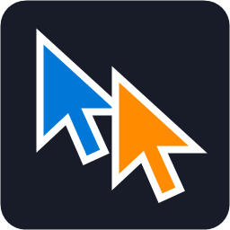
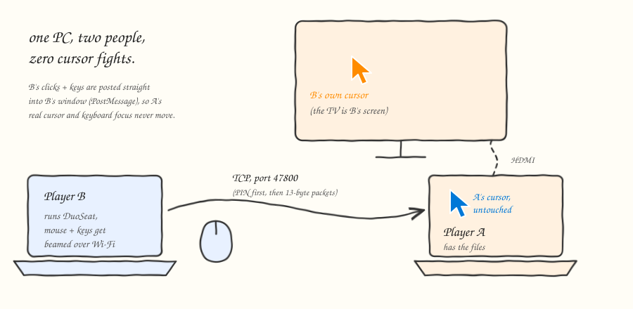
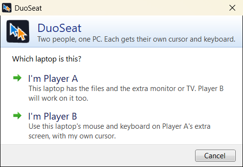
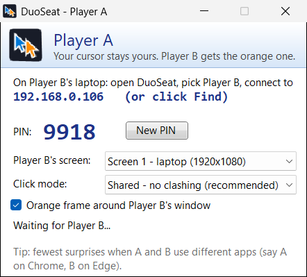
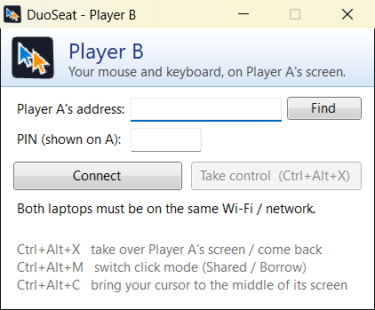

<p align="center"></p>

<h1 align="center">DuoSeat</h1>
<p align="center"><b>Two people. One Windows PC. Zero cursor fights.</b></p>
<p align="center"><a href="https://github.com/basithladdu/duoseat/releases/latest/download/DuoSeat.exe"><b>⬇ Download DuoSeat.exe</b></a> &nbsp;·&nbsp; ~70 KB · Windows 10/11 · nothing to install</p>



You're on your laptop. Your buddy sits next to you, eyes on your TV (it's plugged into *your* laptop), hands on *his own* laptop.
DuoSeat gives him **his own cursor and his own keyboard on your PC**. You both work at the same time. Nobody's mouse gets hijacked, and nobody's typing lands in the other person's window.

## Setup (about a minute)

1. Put `DuoSeat.exe` on both laptops. Same Wi-Fi.
2. **Your laptop:** open it, then **I'm Player A**. Windows asks about the firewall, so click **Allow**.
3. **His laptop:** open it, then **I'm Player B**, then **Find**. Type the PIN shown on yours and hit **Connect**.
4. He presses **Ctrl+Alt+X**. His mouse and keyboard now drive the orange cursor on your TV. Ctrl+Alt+X again gives them back to his laptop.

> "Windows protected your PC"? That's because the exe isn't code-signed (signing costs money). Click **More info**, then **Run anyway**. Or build it yourself, it takes 3 seconds.

| Player B keys | |
|---|---|
| `Ctrl+Alt+X` | take over / come back |
| `Ctrl+Alt+M` | switch click mode: Shared ↔ Borrow |
| `Ctrl+Alt+C` | cursor lost? bring it to the middle |

<p align="center">  </p>

## How it works (the jargon, decoded)

Windows has exactly **one** cursor and **one** keyboard focus. So we don't fight over them. We go around them.

- **Low-level hooks** (`WH_MOUSE_LL`, `WH_KEYBOARD_LL`) on B's laptop: his mouse and keys get caught before his own Windows sees them, then shipped over **TCP** (port 47800, PIN handshake, 13-byte packets).
- **Layered, click-through, topmost window** on A's PC: that's the orange cursor. It's just a picture. The real cursor stays yours.
- **`PostMessage`**: B's clicks, scrolls and keys go straight into the window under the orange cursor. The real mouse never moves.
- **`AttachThreadInput` + `SetKeyboardState`**: B's Ctrl/Shift/Alt are lent to B's app only, so his Ctrl+C doesn't press your Ctrl.
- **`WM_NCHITTEST`**: asks "is this a title bar, an edge or the X button?", then DuoSeat moves, resizes, minimizes or closes the window itself.
- **Borrow mode**: the taskbar, Start, right-click menus and Store apps ignore posted input. For those, the real cursor hops over for a few milliseconds, clicks, hops back, and gives you your window back.

## Honest list

- ✅ **Tested:** both typing at the same moment (A's 120+ keys and B's text, zero mix-ups), browsers (Edge), regular Windows text boxes, Shift/Ctrl+A/Tab/Enter, dragging windows by the title bar.
- 🟡 **Borrow blink:** taskbar, Start, context menus, Settings and Store apps. You'll see your cursor twitch for a few ms.
- 🟡 **Same app for both** (you're both in Chrome): typing is fine; B's shortcuts borrow your keyboard state for about 40 ms. Different apps is the smoothest.
- ❌ **Nope:** games (raw input), admin windows (unless DuoSeat runs as admin), UAC and lock screens, and there's one clipboard (Windows only has one).
- 🔒 PIN-protected, local network only, no accounts, no internet, no telemetry. Not encrypted, so use it on your home Wi-Fi, not café Wi-Fi.

## Build it yourself

No Visual Studio, no SDK. Windows already ships a C# compiler.

```
build.bat
```

That gives you `dist\DuoSeat.exe`.

| File | Does |
|---|---|
| `src/Launcher.cs` | "Player A or Player B?" |
| `src/Host.cs` | Player A window, network listener, orange cursor |
| `src/Injector.cs` | the magic: turns B's input into a second cursor and keyboard |
| `src/Client.cs` | Player B: hooks, capture, auto-reconnect |
| `src/Aero.cs` | the Windows 7 look |
| `src/Common.cs` | protocol and Win32 imports |

## Next up

3+ players, encryption, a Player B for Mac and Linux. PRs welcome, see [CONTRIBUTING.md](CONTRIBUTING.md).

MIT licensed. Do cool stuff with it.
