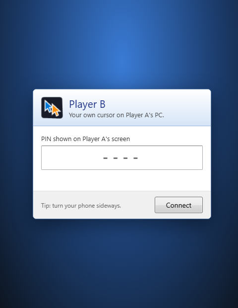

<p align="center"></p>

<h1 align="center">DuoSeat</h1>
<p align="center"><b>Two people. One Windows PC. Zero cursor fights.</b></p>
<p align="center"><a href="https://github.com/basithladdu/duoseat/releases/latest/download/DuoSeat.exe"><b>⬇ Download DuoSeat.exe</b></a> &nbsp;·&nbsp; ~130 KB · Windows 10/11 · nothing to install &nbsp;·&nbsp; <a href="https://duoseat.wedevit.in">duoseat.wedevit.in</a></p>


You're on your laptop. Your buddy sits next to you, eyes on your TV (it's plugged into *your* laptop), hands on *his own* laptop.
DuoSeat gives him **his own cursor and his own keyboard on your PC**. You both work at the same time. Nobody's mouse gets hijacked, and nobody's typing lands in the other person's window.

## Setup (about a minute)

1. Put `DuoSeat.exe` on both laptops. Same Wi-Fi.
2. **Your laptop:** open it, then **I'm Player A**. Windows asks about the firewall, so click **Allow**.
3. **His laptop:** open it, then **I'm Player B**, then **Find**. Type the PIN shown on yours and hit **Connect**.
4. He presses **Ctrl+Alt+X**. His mouse and keyboard now drive the orange cursor on your TV. Ctrl+Alt+X again gives them back to his laptop.

> "Windows protected your PC"? That's because the exe isn't code-signed (signing costs money). Click **More info**, then **Run anyway**. Or build it yourself, it takes 3 seconds.

| Player B keys | |
|---|---|
| `Ctrl+Alt+X` | take over / come back |
| `Ctrl+Alt+M` | switch click mode: Shared ↔ Borrow |
| `Ctrl+Alt+C` | cursor lost? bring it to the middle |

<p align="center">  </p>

## The extras (all on Player A's window)

- **Live view** (Player B's app): A's screen in a window on B's laptop. Mouse over it = your orange cursor over there. Keys go there while it's in front, even Alt+Tab. Up to ~30 fps on Wi-Fi.
- **Virtual screen for B**: no TV? DuoSeat adds a real extra screen with no cable, using the open-source [Virtual Display Driver](https://github.com/VirtualDrivers/Virtual-Display-Driver) (MIT, official release, SHA-256 checked, one Windows permission prompt). B works on it through Live view. Same button removes it.
- **Internet link**: B is in another city? One click opens a private `https://….trycloudflare.com` link through Cloudflare's free tunnel (their signed, official `cloudflared`). The PIN turns 8 digits, and 5 wrong guesses lock the door for a minute.
- **Run as admin**: lets B use admin windows too (Task Manager, installers).
- **Own clipboard for B** (beta): B's Ctrl+C / Ctrl+V use B's own clipboard, so you never paste each other's stuff.
- **Plug a TV in mid-session**: B moves onto it by himself. Pull it out: B comes back to the laptop screen.
- **Lag readout** on B's window. On home Wi-Fi expect a few ms. A network cable between the laptops is the fastest; Bluetooth is slower than Wi-Fi.

Shortcut for B: `DuoSeat.exe --connect 192.168.0.106 --pin 1234 --live` connects and opens Live view straight away.

## No app? Use a browser (phone works)

Player A's window shows a link like `http://192.168.0.106:47800`. Open it on any phone, tablet or laptop on the same Wi-Fi and type the PIN. That's it, nothing to install.

- **Live**: you see B's screen and tap right on it. Pinch to zoom, two fingers to scroll, long-press to right-click.
- **Pad**: the phone turns into a touchpad while you look at the TV. Lower lag, no video.
- **Keys**: brings up the phone keyboard. Esc, Tab, Ctrl, Alt, arrows are on the bar.

Unlike Chrome Remote Desktop, it doesn't steal the one real cursor. You still get your own.

**No TV / no HDMI?** Fine. Player B just shares the laptop screen and watches it in **Live**. Pull the HDMI mid-session and B's cursor hops to the laptop screen on its own.

**Working together:** the live view draws both cursors, A in blue and B in orange, so you can see what the other one is pointing at. **Screen ↻** flips B between the TV and the laptop screen.

<p align="center"></p>

## How it works (the jargon, decoded)

Windows has exactly **one** cursor and **one** keyboard focus. So we don't fight over them. We go around them.

- **Low-level hooks** (`WH_MOUSE_LL`, `WH_KEYBOARD_LL`) on B's laptop: his mouse and keys get caught before his own Windows sees them, then shipped over **TCP** (port 47800, PIN handshake, 13-byte packets).
- **Same port, browser flavour**: a browser says `GET`, so DuoSeat serves one page and upgrades to a **WebSocket**. The screen goes out as **JPEG frames**, one per ack, so a slow phone never builds a backlog.
- **Layered, click-through, topmost window** on A's PC: that's the orange cursor. It's just a picture. The real cursor stays yours.
- **`PostMessage`**: B's clicks, scrolls and keys go straight into the window under the orange cursor. The real mouse never moves.
- **`AttachThreadInput` + `SetKeyboardState`**: B's Ctrl/Shift/Alt are lent to B's app only, so his Ctrl+C doesn't press your Ctrl.
- **`WM_NCHITTEST`**: asks "is this a title bar, an edge or the X button?", then DuoSeat moves, resizes, minimizes or closes the window itself.
- **Borrow mode**: the taskbar, Start, right-click menus and Store apps ignore posted input. For those, the real cursor hops over for a few milliseconds, clicks, hops back, and gives you your window back.

## Honest list

- ✅ **Tested:** both typing at the same moment (A's 120+ keys and B's text, zero mix-ups), browsers (Edge), regular Windows text boxes, Shift/Ctrl+A/Tab/Enter/Backspace, dragging windows by the title bar, the browser Player B from a desktop browser (live view, clicks, typing, auto-reconnect).
- ✅ **Phone gestures** (tested with simulated touch): tap, long-press right-click then picking from that menu, two-finger scroll, pinch zoom, Ctrl button + key, autocorrect rewriting a word, Pad slide + tap. A's cursor and active window stayed put the whole time. Not yet run on a physical phone; found a quirk? Open an issue.
- 🟡 **Borrow blink:** taskbar, Start, context menus, Settings and Store apps. You'll see your cursor twitch for a few ms.
- 🟡 **Same app for both** (you're both in Chrome): typing is fine; B's shortcuts borrow your keyboard state for about 40 ms. Different apps is the smoothest.
- ✅ **Two real laptops:** B on his own laptop over home Wi-Fi, cursor on A's TV, typing while A typed.
- ✅ **Also tested:** app Live view (click + type through it), internet link (page + live picture through Cloudflare, ~180 ms to first frame), own clipboard (A's stays A's).
- 🟡 **Virtual screen:** the install path is new; the driver itself is widely used. Tell us if it misbehaves.
- ❌ **Nope (Windows says no):** games that read raw input, the UAC prompt and the lock screen (Windows' secure desktop).
- 🔒 PIN-protected, no accounts, no telemetry. On Wi-Fi it's not encrypted, so use your home Wi-Fi. The internet link is HTTPS end to end through Cloudflare.

## Build it yourself

No Visual Studio, no SDK. Windows already ships a C# compiler.

```
build.bat
```

That gives you `dist\DuoSeat.exe`.

| File | Does |
|---|---|
| `src/Launcher.cs` | "Player A or Player B?" |
| `src/Host.cs` | Player A window, network listener, orange cursor |
| `src/Injector.cs` | the magic: turns B's input into a second cursor and keyboard |
| `src/Client.cs` | Player B: hooks, capture, auto-reconnect |
| `src/Web.cs` + `web/index.html` | Player B in a browser: tiny HTTP + WebSocket server, JPEG live view |
| `src/Viewer.cs` | Player B's Live view window |
| `src/Extras.cs` | virtual screen, internet link, signature checks, PIN lockout, own clipboard |
| `src/Aero.cs` | the Windows 7 look |
| `src/Common.cs` | protocol and Win32 imports |
| `site/` | the website, a Cloudflare Worker serving static files (`cd site && wrangler deploy`) |

## Next up

3+ players, encryption, a Player B for Mac and Linux. PRs welcome, see [CONTRIBUTING.md](CONTRIBUTING.md).

MIT licensed. Do cool stuff with it.
